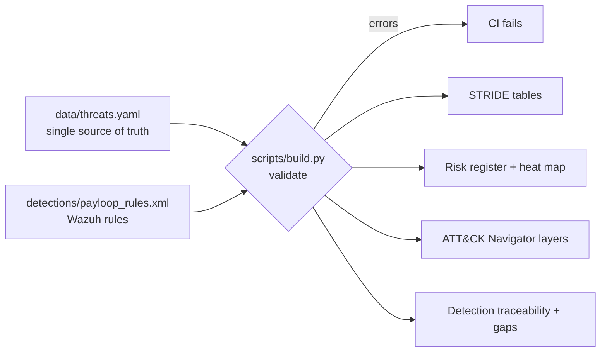

# payloop-threat-model: a threat model that drives detections

A STRIDE threat model of **PayLoop**, a fictional mobile-money wallet platform, kept as **data** instead of a slide deck. One YAML file
generates the tables, the risk register, an ATT&CK Navigator heat map and a **threat-to-detection traceability report**.
A build step fails if a high-risk threat has no detection and no written reason why.



## Run it
```bash
pip install pyyaml
python3 scripts/build.py          # validate and regenerate docs/ and the Navigator layers
python3 scripts/build.py --check  # CI mode: fail if generated files are stale
./scripts/check_diagrams.sh       # render every Mermaid diagram (needs: npm i -g @mermaid-js/mermaid-cli)
```

## Read it in this order
| Doc | Content |
|---|---|
| [01 System description](docs/01-system-description.md) | Objectives, assets, actors, trust boundaries, assumptions, out of scope |
| [02 Data flow and attack tree](docs/02-data-flow.md) | DFD with trust boundaries, flow table, attack tree for stealing funds |
| [03 STRIDE analysis](docs/03-stride-analysis.md) | Per-element tables and an element x category coverage matrix |
| [04 ATT&CK mapping](docs/04-attack-mapping.md) | Technique to threats to detections |
| [05 Risk register](docs/05-risk-register.md) | Likelihood x impact, heat map, residual risk statements |
| [06 Detection traceability](docs/06-detection-traceability.md) | Which rule covers which threat, and an honest list of gaps |
| `attack-navigator-layer.json` | Inherent risk by technique (import into ATT&CK Navigator) |
| `attack-navigator-detection-layer.json` | Detection coverage by technique |

## What makes it useful rather than decorative
- **Every threat has a scenario, controls, a residual-risk sentence and a status** (`mitigated`, `partial`, `open`, `accepted`). Open items are listed, not hidden.
- **Detections are checked, not claimed.** Each referenced Wazuh rule id must exist in the ruleset or the build fails; high-risk threats without a detection must say why.
- **Threats link to real findings.** Several threats point to findings F1 to F9 that were exploited and fixed in the companion `payloop-vuln-lab`, and their detections are replay-tested there.
- **Gaps are first-class.** Threats such as race conditions, supply chain and TLS are preventive controls with no runtime signal; the report says so and names the compensating control.

## Limits
- Scores are judgement calls (likelihood x impact on a 1 to 5 scale); they rank work, they do not measure it.
- The ATT&CK mapping is to the technique level. Pick the sub-technique and the version (`attack_version` in the YAML) you want to defend.
- The model describes a fictional system built for practice. It is a method demonstration, not an assessment of any real platform.

## Interview walk-through (about 6 minutes)
1. Open `docs/02-data-flow.md`: trust boundaries first, then one flow end to end.
2. Show the attack tree and pick two leaves: one with a detection, one without. Explain why the second needs reconciliation, not a rule.
3. Edit `data/threats.yaml` live: break a rule id, run `build.py`, show it fail; fix it, show it pass.
4. Open `docs/06-detection-traceability.md`: coverage number, then the gap table.
5. Import the Navigator layers and talk about where the model is weakest.
