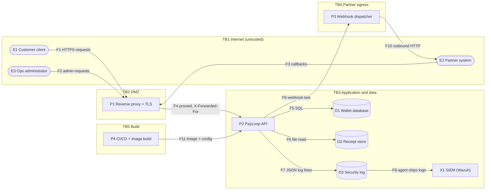
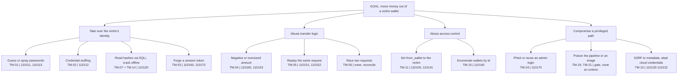

# 2. Data flow diagrams and attack tree

## Level 1 data-flow diagram

### Flows
| Flow | From | To | Data | Protocol | Crosses |
|---|---|---|---|---|---|
| F1 | E1 | P1 | credentials, transfer requests | HTTPS | TB1 to TB2 |
| F2 | E3 | P1 | admin actions | HTTPS | TB1 to TB2 |
| F3 | E2 | P1 | partner callbacks | HTTPS | TB1 to TB2 |
| F4 | P1 | P2 | proxied requests | HTTP | TB2 to TB3 |
| F5 | P2 | D1 | SQL, balances, hashes | local socket / file | inside TB3 |
| F6 | P2 | D2 | receipt files | filesystem | inside TB3 |
| F7 | P2 | D3 | security events (never bodies or secrets) | file append | inside TB3 |
| F8 | D3 | X1 | log lines | agent over TLS | inside TB3 |
| F9 | P2 | P3 | URL to test | in process | TB3 to TB4 |
| F10 | P3 | E2 | webhook request | HTTPS | TB4 to TB1 |
| F11 | P4 | P2 | images, configuration | registry / deploy | TB5 to TB3 |

## Attack tree: steal funds from a customer wallet

Leaves carry the threat id (TM-nn) and the detection that would see it.

Reading the tree: the branches where the detection column says "none" are exactly the ones that need preventive controls or
reconciliation, which is why the traceability report lists them with the reason.
